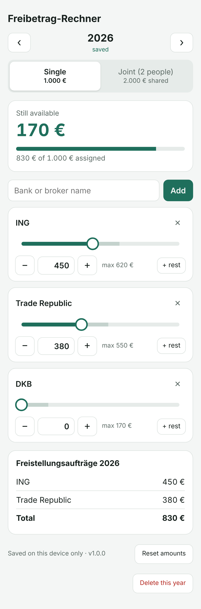

# Freibetrag-Rechner

[](https://github.com/VSamokhin/freibetrag-rechner/actions/workflows/ci.yml)
[](https://github.com/VSamokhin/freibetrag-rechner/actions/workflows/codeql.yml)
[](LICENSE)

A small offline web app for splitting the German **Sparerpauschbetrag** across your banks and brokers before
you send each of them a **Freistellungsauftrag**.

<p align="center"></p>

## Features

- **Single or joint:** 1.000 € for one person, or 2.000 € shared by a couple assessed jointly.
- **Account holders (joint):** name both people, assign each institution to one of them, and see the results
  grouped by person.
- **Institutions:** add, rename and remove banks and brokers.
- **Precise amounts:** each institution has a slider that moves in 10 € steps, −/+ buttons for 1 € steps
  (hold one down to repeat), a number field, and a "+ rest" button.
- **Free balance always visible:** an institution can only take money from the free balance, so the total can
  never be exceeded.
- **Results list:** shows every Freistellungsauftrag with an amount above 0 €, plus the total.
- **One save per year:** start a new year as a copy of the most recent earlier year, or start with an empty list.
- **English and German:** follows the browser language; switch any time with EN/DE in the header.
- **Private and offline:** no account, no server and no tracking. Data stays in your browser's local storage,
  and the app can be installed on Android as a Progressive Web App (PWA).

> This tool is a calculator, not tax advice. Please check the current limits for your situation.

## Using it

1. Open the hosted app in Chrome on Android: <https://vsamokhin.github.io/freibetrag-rechner/>.
2. Tap the menu, then **Install app** (or **Add to Home screen**).
3. The app opens fullscreen and works without an internet connection.

Your data lives only on that device. Clearing the browser's site data or uninstalling the app (if you choose to
remove its data) deletes it.

## Development

Requirements: Node.js 22 (see `.nvmrc`).

```bash
npm install        # also installs the git pre-commit hook
npm run dev        # build and serve dist/ locally
npm run verify     # run every gate (the same as the pre-commit hook and CI)
```

| Script                  | What it does                                                            |
| ----------------------- | ----------------------------------------------------------------------- |
| `npm run build`         | Bundles `src/` with esbuild and copies `public/` into `dist/`           |
| `npm run format:check`  | Prettier formatting check (`npm run format` fixes it)                   |
| `npm run lint`          | ESLint with typescript-eslint (strict, type-checked) and security rules |
| `npm run typecheck`     | TypeScript in strict mode                                               |
| `npm run test:coverage` | Vitest unit and DOM tests, failing below the coverage thresholds        |
| `npm run secrets`       | secretlint scan for committed credentials                               |
| `npm run audit`         | `npm audit` failing on moderate or higher vulnerabilities               |

### Quality gates

| Gate            | Tool                                                              | Fails when                                                        |
| --------------- | ----------------------------------------------------------------- | ----------------------------------------------------------------- |
| Formatting      | Prettier                                                          | Any file is not formatted                                         |
| Code quality    | ESLint, `typescript-eslint` strict + stylistic, complexity limits | Any error or warning                                              |
| Security (code) | `eslint-plugin-security`, no `innerHTML`/`eval`, CodeQL in CI     | Any finding                                                       |
| Security (deps) | `npm audit`, Dependabot                                           | A moderate or higher advisory                                     |
| Secrets         | secretlint                                                        | A credential-like string is found                                 |
| Types           | `tsc --strict --noUncheckedIndexedAccess`                         | Any type error                                                    |
| Tests           | Vitest + jsdom                                                    | Any failing test                                                  |
| Coverage        | `@vitest/coverage-v8`                                             | Lines, statements or functions under 90 %, or branches under 85 % |

The pre-commit hook (Husky) runs `npm run verify`. GitHub Actions runs the same command on every pull request
to `main` and every push to `main`. CodeQL also runs on those events and weekly.

The page also ships a strict Content Security Policy: scripts only from its own origin, no inline scripts.

### Project layout

```
src/model.ts     domain logic: amounts, limits, years, persistence format (pure, fully tested)
src/app.ts       UI: rendering and interaction
src/i18n.ts      UI texts in English and German, language detection
src/main.ts      entry point, service worker registration
src/version.ts   app version, injected at build time (see Versioning)
public/          index.html, manifest, service worker, icons
scripts/         build script and git-derived version (version.mjs)
tests/           unit tests (model) and DOM tests (app)
```

## Versioning

The version has the form `major.minor.build` and is **derived from the git history** by
[`scripts/version.mjs`](scripts/version.mjs):

- `package.json` commits only a **base** version, e.g. `0.1.0`.
- The real version is the base build part plus the number of first-parent commits since the commit that last
  changed the `"version"` line. Example: base `0.1.0` with three commits on `main` since then gives `0.1.3`.
- Nobody bumps the build part by hand. Every commit that reaches `main` (Dependabot merges included) gets a higher
  version automatically, and parallel branches never conflict over a version bump.
- **Minor:** raised by hand in the change that brings new functionality
  (`npm version minor --no-git-tag-version`). The count restarts from that commit.
- **Major:** raised only with the owner's agreement.
- Builds need the full git history. CI checks out with `fetch-depth: 0`. In a shallow clone the build fails on
  GitHub Actions and falls back to the base, with a warning, locally.

The build stamps the derived version into the app (visible in the footer) and into the service worker's cache
name, so installed apps pick up new versions. `node scripts/version.mjs` prints the current version, and
`node scripts/version.mjs --base` prints the committed base.

Notable changes are listed per minor version in [CHANGELOG.md](CHANGELOG.md).

## Releases

The hosted app on GitHub Pages is deployed **only from published releases**:

- [Release Drafter](.github/workflows/release-drafter.yml) keeps a draft release named after the current version
  of `main` (`v0.2.3`), with the merged pull requests as notes, grouped by their branch prefix: `feature/`,
  `bugfix/` and `chore/` pull requests are labelled automatically.
- Publishing that draft creates the tag, and [Deploy to GitHub Pages](.github/workflows/pages.yml) builds the tag
  after the full `npm run verify`, checks that it builds the release's version, and deploys it.
- **Run workflow** on that workflow redeploys the latest release, or a tag you name.
- Pushes to `main` never change the hosted app by themselves.

## License

[MIT](LICENSE): free to use, copy, modify and distribute.
